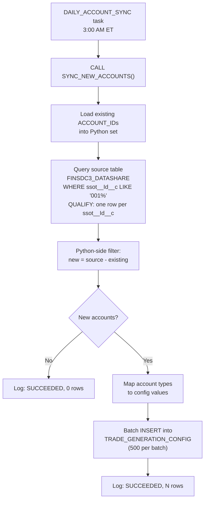

# Account Sync Pipeline

## Overview

The account sync pipeline imports new accounts from a Salesforce Data Cloud shared table into the local `TRADE_GENERATION_CONFIG` table. It runs daily at 3:00 AM ET via the `DAILY_ACCOUNT_SYNC` task (a direct call with 2 task retries since [migration 006](../migrations/006_task_timeout_layering.sql); `SP_RETRY_WRAPPER` before), ten minutes before `DAILY_TRADE_GENERATOR`. It is **insert-only**: rows already in the table are never updated (see [Existing rows are never updated](#existing-rows-are-never-updated)).

## Source Data

| Property | Value |
|---|---|
| Database | `FINSDC3_DATASHARE` (shared/secure) |
| Schema | `"schema_Jedi_Snowflake"` (mixed-case, must be double-quoted) |
| Table | `"ssot__Account__dlm"` (all column names must be double-quoted) |

### Source Columns Used

| Source Column | Maps To | Notes |
|---|---|---|
| `"ssot__Id__c"` | `ACCOUNT_ID` | Filtered to `001%` pattern |
| `"ssot__Name__c"` | `ACCOUNT_NAME` | Must be non-null and non-blank |
| `"ssot__AccountTypeId__c"` | Mapped to multiple config columns | See type mapping below |

## Account Type Mapping

The source `AccountTypeId` is mapped to five configuration columns:

| Source Type | Account Type | Frequency | Trades/Period | Risk Profile | Max Trade Value |
|---|---|---|---|---|---|
| Enterprise | Institutional | DAILY | 12 | Moderate | $500,000 |
| Mid-Market | Institutional | DAILY | 8 | Moderate | $300,000 |
| Small Business | Retail | WEEKLY | 4 | Conservative | $100,000 |
| Client | Retail | DAILY | 6 | Moderate | $200,000 |
| Person | Retail | MONTHLY | 3 | Conservative | $50,000 |
| Partner | Institutional | WEEKLY | 10 | Aggressive | $400,000 |
| Investor | Institutional | DAILY | 15 | Aggressive | $750,000 |
| Consultant | Retail | MONTHLY | 2 | Conservative | $75,000 |
| Other/NULL | Retail | WEEKLY | 5 | Moderate | $150,000 |

## Pipeline Flow



## Secure Object Limitations

The source table is a shared/secure object from Salesforce Data Cloud. This imposes several restrictions:

| Limitation | Workaround |
|---|---|
| `COUNT(*)` with `WHERE` clause fails | Load all rows into Python, filter client-side |
| `CTAS` with `TRIM()` fails | Avoid CTAS; use direct INSERT |
| `INSERT ... SELECT` with subqueries fails | Collect rows into Python, then batch INSERT with parameters |
| Mixed-case schema/column names | Always double-quote: `"schema_Jedi_Snowflake"`, `"ssot__Id__c"` |

## Implementation Details

- **Duplicate prevention**: Existing account IDs are loaded into a Python `set` before querying the source. New accounts are identified by set difference, not by SQL anti-join (which would fail on the secure object).
- **Source dedupe**: the share carries more than one copy of some IDs (for example an `Account` copy and a `PartyRelationshipGroup` copy). The read keeps one row per `ssot__Id__c` with a total ordering: `Account` data-source object first, then newest `ssot__LastModifiedDate__c`, then `HASH(s.*)` as the tie-break. Without it a duplicated new ID would be inserted twice with an arbitrary name and type.
- **No org filter**: the share holds accounts from five Salesforce orgs (`ssot__DataSourceId__c`), and the sync doesn't filter by org, so all of them are imported. No ID appears in more than one org. Migration 005 deactivated the non-`Salesforce_Home` ones, but a new account from those orgs is still inserted as active. See the distribution below.
- **Batch size**: 500 rows per INSERT to stay within Snowflake parameter limits.
- **Notes field**: All imported accounts are tagged with `"Auto-imported from ssot__Account__dlm"`.
- **ACTIVE flag**: All new accounts default to `TRUE`.
- **LAST_GENERATED_DATE**: Left as `NULL` for new accounts -- the trade generator will treat them as due on its first run.

## Existing rows are never updated

`SYNC_NEW_ACCOUNTS()` only inserts IDs it hasn't seen, and `GENERATE_DAILY_TRADES()` only updates `LAST_GENERATED_DATE` and `LAST_UPDATED`. So:

- a Salesforce rename or account-type change never reaches an existing config row;
- an edit to the type mapping above applies to new accounts only;
- manual edits to a config row persist.

To bring existing rows back in line, write a one-off migration in [`migrations/`](../migrations/) that clones the table first, then runs `UPDATE ... FROM` the deduped source joined to the type map. The dedupe and the type map must match `procedures/sync_new_accounts.sql`. Three such migrations ran on 2026-11-04:

| Migration | Rows | Change | Rollback clone |
|---|---|---|---|
| [`003`](../migrations/003_backfill_config_name_type_from_source.sql) | 31,053 | `ACCOUNT_NAME` from source on 25,425 rows (mostly a middle initial added in Salesforce, e.g. "Harry Gray" → "Harry P Gray"). On 5,628 `Partner` rows stored as Retail: `ACCOUNT_TYPE` → Institutional plus the Partner settings (WEEKLY / 10 / Aggressive / $400K) | `TRADE_GENERATION_CONFIG_BAK_20261104` |
| [`004`](../migrations/004_backfill_config_profile_from_type_map.sql) | 25,379 | `Person` rows on the default WEEKLY / 5 / Moderate / $150K → MONTHLY / 3 / Conservative / $50K | `TRADE_GENERATION_CONFIG_BAK_20261104_M004` |
| [`005`](../migrations/005_deactivate_non_home_org_accounts.sql) | 529 | `ACTIVE` → FALSE on every account with no `Salesforce_Home` row in the share. Their 1,663,666 trades stay in `FINANCIAL_TRADES` with `ACCOUNT_ID` intact | `TRADE_GENERATION_CONFIG_BAK_20261104_M005` |

After 003 and 004, 0 of the 36,768 source-matched rows differ from the source on name or type, or from the type map on frequency, trades per period, risk profile or max trade value. Touched rows carry a `| ... (migration 003)` / `(migration 004)` suffix on `NOTES`. Trades already generated weren't rewritten. All rows updated by 003 and 004 are `Salesforce_Home` accounts. Rows deactivated by 005 carry `| deactivated 2026-11-04: non-Salesforce_Home org <org> (migration 005)` on `NOTES`.

## Current Account Distribution

As of 2026-11-04:

| Source (`ssot__DataSourceId__c`) | Config rows | Active | Trades |
|---|---|---|---|
| `Salesforce_Home` | 36,239 | 36,239 | 4.77M |
| `Salesforce_InsuranceAFDC` | 167 | 0 (migration 005) | 460K |
| `Salesforce_FinsDC4` | 146 | 0 (migration 005) | 449K |
| `Salesforce_FinsDC1` | 127 | 0 (migration 005) | 380K |
| `Salesforce_DCCDO1` | 89 | 0 (migration 005) | 334K |
| Manual `TRD-xxx` placeholders | 5 | 0 (deactivated by migration 001) | 0 (deleted by migration 009) |
| **Total** | **36,773** | **36,239** | **6.42M** |

Trade counts are after migration 007, which deleted the duplicate Monday trade sets (4,195,785 rows). The 35,116 NULL-`ACCOUNT_ID` trades from the `TRD-` placeholders were deleted by migration 009 on 2026-11-09 (no cockpit query, segment or calculated insight read them); they are kept in `FINANCIAL_TRADES_TRD_BAK_20261109`. Migrations 008, 010 and 011 later added back-filled trades, so the live total is now about 6.62M. See "Known data gaps" in the [README](../README.md). The 529 accounts from the four non-Home orgs don't join to the Home org the cockpits read, so migration 005 deactivated them. Their trades were kept. Adding a `Salesforce_Home` filter to `SYNC_NEW_ACCOUNTS()`, so new non-Home accounts aren't imported as active, is still open.

## Execution Logging

Every sync execution writes to `TASK_EXECUTION_LOG`:

```sql
-- Check recent sync results
SELECT TASK_NAME, STATUS, ROWS_INSERTED, ACCOUNTS_PROCESSED, ERROR_MESSAGE, DURATION_MS
FROM DATA_JEDAIS.FINS__PUBLIC.TASK_EXECUTION_LOG
WHERE TASK_NAME = 'ACCOUNT_SYNC'
ORDER BY EXECUTION_TIME DESC
LIMIT 10;
```
