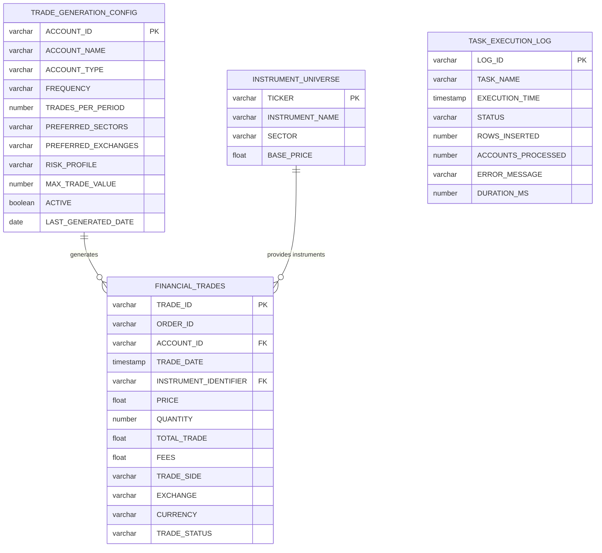
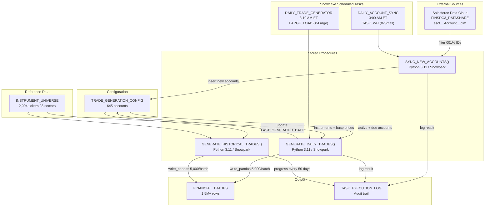
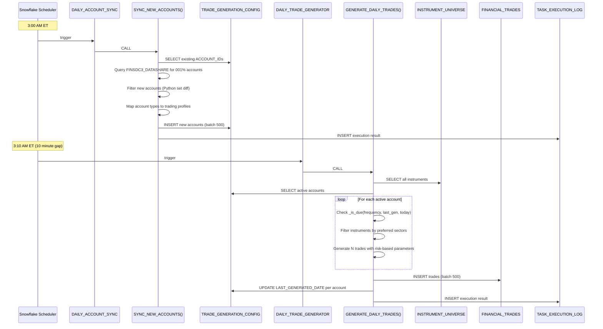

# Architecture and Data Flow

## System Overview

The Financial Trades Generation system is a Snowflake-native data pipeline that produces realistic synthetic trade data. It runs entirely within Snowflake using scheduled tasks, Python stored procedures (Snowpark), and reference/configuration tables.

## Entity Relationship Diagram

## Data Flow Diagram

## Daily Pipeline Sequence

## Warehouse Strategy

| Warehouse | Size | Purpose | Used By |
|---|---|---|---|
| `TASK_WH` | X-Small | Daily account sync | `DAILY_ACCOUNT_SYNC` |
| `LARGE_LOAD` | X-Large | Daily trade generation and bulk historical backfill | `DAILY_TRADE_GENERATOR`, `GENERATE_HISTORICAL_TRADES()` (manual) |

The daily tasks run on X-Small since they process a single day's trades (~3,100 per run). Historical backfill requires X-Large to handle hundreds of days and millions of rows without timeouts.

## Key Design Decisions

1. **Python Snowpark over SQL**: Trade generation requires complex randomization (weighted choices, jitter, UUID generation) that is more naturally expressed in Python than SQL.

2. **EXECUTE AS OWNER**: Procedures run with owner privileges to access shared database objects. This introduces a limitation: temporary tables cannot be created inside these procedures. (`write_pandas` still works in both generators: its temporary stage is allowed.)

3. **Batch loading**: Trades are accumulated in Python lists and flushed in batches. Both generators load each 5,000-row batch with `session.write_pandas` (one PUT + COPY, ~2 s), since 2026-11-04. Before that they used a parameterized multi-row `INSERT INTO ... VALUES` (5,000 rows in the daily generator, 500 in the historical one), and compiling those statements took most of the run: ~18 s per 5,000-row batch.

4. **Frequency gating in Python**: The `_is_due()` function runs client-side (in the procedure) rather than as a SQL filter, because the logic depends on per-account state that evolves as the procedure iterates through days.

5. **10-minute task gap**: Account sync at 3:00 AM ET, trade generation at 3:10 AM ET. This ensures newly imported accounts are committed and visible before the generator reads them. The sync has a 300 s statement timeout, so it finishes or fails inside the gap. Both tasks call their procedure through `SP_RETRY_WRAPPER(…, 2)` until [migration 006](../migrations/006_task_timeout_layering.sql) is applied. 006 makes them call it directly, with `TASK_AUTO_RETRY_ATTEMPTS = 2` as the only retry layer and the generator's statement timeout (3,000 s) below the task timeout (3,600 s). With the wrapper, three 1,800 s attempts couldn't fit in one 3,600 s task run, and on 2026-11-02 one task run plus its two retries made 6 attempts.

6. **Resume capability**: The historical backfill procedure seeds its `last_gen` dict from each account's last trade before `START_DATE`, so WEEKLY/MONTHLY triggers carry across chunks. It also skips (account, day) pairs already in `FINANCIAL_TRADES` inside the chunk, and flushes only between accounts, so a chunk can be re-run after a timeout without duplicates (since 2026-11-04).
